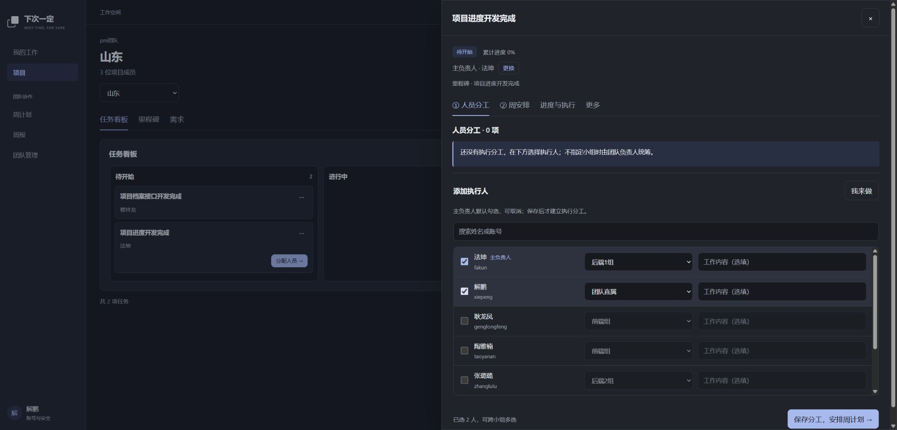

# 团队直属分工调整记录

日期：2026-10-15。范围：无小组成员的任务分配及周计划、周报、责任调整联动。

## 实现

- 分工的 `groupId` 可为 `null`，界面显示“团队直属”。团队负责人可为同团队可用成员分配直属工作，成员可认领自己的直属工作；指定小组时仍校验成员资格。
- 人员选择器保留主负责人默认勾选和手工取消，未入组成员可选且默认直属，不自动创建小组或修改成员的小组关系。
- 直属分工纳入周安排候选、投入汇总、未完成延续、发布及周报；小组长不能通过执行人的其他小组取得直属分工的安排、标签、周报或关联调整权限。
- 转交、拆分、个人工作关联和认领通知使用相同责任边界。本人实际执行限制和已发布历史保留规则继续生效。

业务规则见[产品需求](../product/需求说明书.md)与[研发需求](../product/研发需求说明书.md)，操作说明见[任务与个人执行](任务与个人执行使用说明.md)、[周计划与周报](周计划与周报使用说明.md)。

## 数据库

- 新增迁移 `1792022400000-team-direct-assignments.ts`，仅将 `task_assignments.group_id` 改为可空并更新中文注释，保留已有小组值和外键。
- 已在本地 `127.0.0.1:3306/next_time_for_sure`、MySQL 5.7.35-log 执行，迁移无待执行项，实际中文注释检查 271/271。
- 回读字段确认 `IS_NULLABLE=YES`，注释为“负责小组标识；空表示由团队负责人统筹的团队直属分工”。存在直属分工时拒绝回退为必填小组，避免隐式改动归属。

## 验证

- Contracts、API、Web、MCP 类型检查及相关代码 ESLint 通过；Web 生产构建通过，保留既有第三方 Zod 注释与大包警告。
- 真实 HTTP + MySQL 专项 `team-direct.integration.ts` 通过：无小组分配/本人认领、Cookie 与 Bearer 幂等一致、批量原子性、跨角色权限拒绝、周安排/发布/延续、周报、发布历史不变、直属和小组切换、转交、拆分、通知、无小组个人工作关联。
- 完整周计划回归通过；完整任务回归单独运行通过。首次与周计划并行运行时，任务回归在阻塞用例的分工创建处出现一次 HTTP 500；单独重跑未复现，未确定根因，不将其记录为已定位修复。
- 实际用户网页验证主负责人默认勾选、解鹏可选以及默认“团队直属”；只修改未提交的表单选择，关闭验收页签后丢弃，没有替用户任务保存分工。
- 隔离测试夹具已自动清理，临时搜索文件和验收页签已清理。未单独运行 Electron 或外部 Agent 联调，未提交或部署。

## 页面证据

