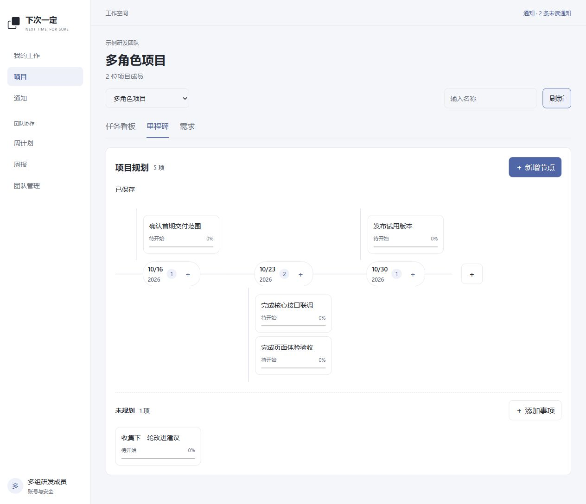

# 工作区体验改造记录

日期：2026-10-14。范围：当前网页工作区及 Electron 运行时品牌图标。第6阶段原有桌面账号切换、Codex写入等未完验收不因本轮界面改造自动完成。

## 已落地

| 范围 | 当前行为 |
| --- | --- |
| 工作区 | 共享窄侧栏、错位方块标志、雾蓝控件与清晰的当前导航；普通成员登录后进入我的工作，超管进入团队管理；受保护链接登录后返回原目标。移除早期工程状态首页与失去调用的健康检查前端封装，后端健康接口继续保留。 |
| 项目 | 看板、里程碑、需求分别切换；项目与视图进入URL，任务深链接打开统一详情侧栏；搜索只过滤展示，不截断排序命令所需的完整任务版本集合。 |
| 里程碑 | 新增内容只填名称，已有日期组自动带入日期，留空进入未规划；可加入已有任务。节点上按既有权限改名、保存累计进度、开始与确认完成；改期及移出保留原因，不删除原任务。默认负责人见产品需求4.2。 |
| 鱼骨布局 | 上下分支共享日期主轴，同日显示多个事项及数量；窄屏转换为纵向。落点提示使用绝对定位，不再撑高分支使落点移动；进入、经过落点都明确接受移动操作。 |
| 个人工作 | 日常卡片仅显示标题、状态、计划日期、阻塞、检查项摘要与快捷操作；详情、进展、历史及低频管理进入侧栏。新建事项和分类管理分别打开；不再让用户输入内部排序位置。 |
| 周计划与周报 | 周次支持前后切换及任意日期归一化；周计划用紧凑卡片和按需编辑窗口，编排与预览发布分开。周报默认阅读条目，按需编辑，来源追溯不暴露内部标识；已发布版本独立切换。 |
| 团队与通知 | 目录按项目、成员、小组、团队与总览分区，无权管理时隐藏入口；归档交接与通知分离。编辑项目成员时回填现有角色；分配执行人时按所选小组筛选。 |
| 账号与品牌 | 登录后返回工作区；账号密码和Agent访问令牌分区。网页favicon与Electron运行时窗口／托盘图标采用错位方块。 |

## 验证证据

- `scripts/pnpm.ps1 check`：类型检查、Lint、8项现有单元测试和全部工程构建通过；最终导航调整后另行通过前端构建与Lint。Vite仍提示主包超过500kB，尚未进行路由分包优化。
- `scripts/pnpm.ps1 work:smoke`：真实HTTP＋MySQL验证权限、版本竞争、同日节点、未规划、移出再加入、共享任务、人员分工、个人事项、父子拆分、排序及阻塞；随机夹具由脚本清理。
- `scripts/pnpm.ps1 weekly:smoke`：真实HTTP＋MySQL验证周计划候选范围、跨项目小组权限、发布版本、再生成及隐私边界；随机夹具由脚本清理。
- 浏览器实际登录示例成员后进入我的工作；验证项目视图切换、名称新增、改名、保存45%累计进度、改期创建新日期组、移出保留任务及打开同一任务侧栏。
- 实际拖动“确认首期交付范围”至另一日期组，显示确认并保存；API回读日期一致，随后用API恢复示例原日期。
- 新增／改名／进度／移出结果经过API与MySQL回读：测试节点名称正确、进度45%、已移出里程碑、日期为空。随后仅清理该测试节点及其关联通知、幂等和历史记录，未清理其他工作。
- 周次输入任意工作日可归入 `2026-11-02～2026-11-08`；采用input事件避免某些浏览器填日期后界面范围不更新。
- 390×844窄屏检查纵向鱼骨、导航可访问、新增窗口及Esc关闭；文档宽度未超出视口。深色、浅色页面已目视检查，浏览器控制台无错误。

## 保留与边界

- 示例项目保留5条有业务名称的未开始事项，覆盖多个日期、同日多事项及未规划，供后续试用；不表示真实研发进展。临时“交互验收节点”已清理。
- 本轮没有数据库结构变更，没有修改后端权限或状态规则。管理者不会因为能维护规划而获得代改他人任务内容或进度的权限。
- 原型源码与导出保留为设计基准，不作为正式应用运行证据；正式页面行为以代码、产品规则及本记录为准。
- Electron图标源码已构建及通过现有测试；本轮没有重新打包、安装客户端，也没有重新进行完整Windows系统通知验收。
- 未对每个角色的全部页面路径逐一进行人工操作，权限依赖真实API回归；尚未验证大规模节点性能及真实手机浏览器，390像素验证是桌面浏览器视口模拟。

## 页面截图

[深色页面](evidence/ux/milestones-dark.jpg) · [390像素窄屏](evidence/ux/milestones-mobile.jpg)
