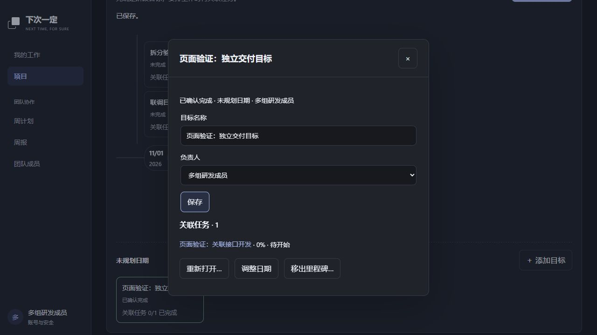
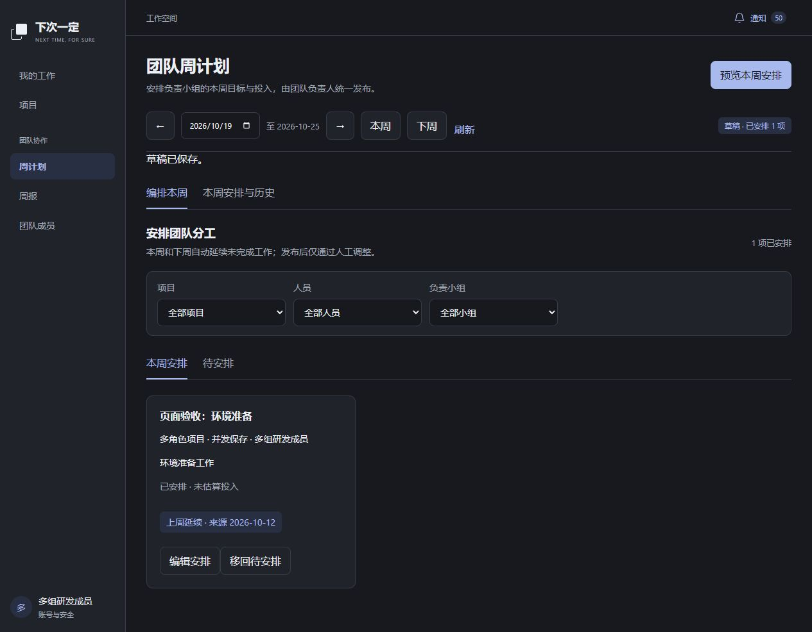

# 里程碑与周安排调整记录

日期：2026-10-15。对应产品 v0.26、研发需求 v1.9。本记录说明本地实现和验证证据，不表示生产部署或外部 Agent 客户端验收完成。

## 行为变化

- 里程碑是独立目标，创建目标不创建团队任务。目标可关联多条同项目任务，任务最多关联一个目标，也可不关联。
- 创建任务时选择目标，已有任务在详情调整关联；拆分子任务默认继承关联，跨项目转移清除原关联。
- 目标由当前负责人确认完成或填写原因重新打开；关联任务数量与完成情况仅作参考，二者状态互不自动修改。移出目标解除关联，保留任务、分工与执行历史。
- 周安排默认本周，提供“下周”快捷入口，分别展示已安排和待安排工作。未纳入该周的任务不会混入已安排列表。
- 本周、下周按当前权限补入往期仍有效的未完成工作，保留原任务、分工及历史周，标明来源周。已完成、取消、转出或退出的工作不延续；新周目标、进度和天数重新填写。
- 已有安排不覆盖，主动移回待安排后不因刷新重新加入；重新人工安排后可继续延续。目标周已有正式计划时停止自动补入，已发布计划与周报快照保持不变。

## 实现与兼容边界

`IndependentMilestones1791936000000` 新增 `project_milestones`、任务的可空 `milestone_id`、`weekly_carry_exclusions` 和待分配事项的 `source_week`。旧节点迁移为独立目标并关联原任务，原任务及历史不删除；旧节点完成状态作为迁移基线保留。旧任务日期字段保留兼容，不再随目标日期变化。

目标创建使用操作标识保证幂等；修改使用版本校验。目标、任务关联、权限和事件写入在后端事务中处理，页面和 Agent API 共用规则。目标负责人须为同项目可用研发成员；已发布工作关联目标的明确交付日期变更仍需团队负责人确认。

自动延续按上海日历确定本周和下周，在有权用户读取草稿、执行安排命令或生成发布预览时按需补入；不是后台定时任务。周报预览同时初始化下周安排。历史周及远期周不会自动创建，仍可明确安排。读取草稿可能产生受权限约束的草稿和延续事件；组织锁与去重查询保证重复读取不会重复加入。

项目归档检查未完成目标；成员交接列表纳入未完成目标责任。移出目标保留历史，目标创建本身不进入任务待办。

## 验证证据

| 层次 | 已执行结果 |
| --- | --- |
| 静态、单测与构建 | `scripts/pnpm.ps1 check` 通过：全工作区类型检查、ESLint、API/MCP/桌面单测和构建；构建仍有既有注解与包体大小提示。 |
| 里程碑真实 API | `work:smoke` 通过：创建不增任务、创建幂等、权限与同项目约束、一对多关联、创建任务同时关联、版本并发冲突、任务与目标独立完成、移出保留任务历史。 |
| 周安排真实 API | `weekly:smoke` 通过：当前周和下周自动延续、缺周补入、权限范围、完成项排除、手工安排保留、重复读取去重、主动移出不复活、待分配延续及发布冻结；原周报回归通过。 |
| 生命周期真实 API | `lifecycle:smoke` 通过：转移、归档、删除限制、成员移出与交接、通知及组织权限回归。 |
| MCP 适配层 | `agent:smoke` 通过：真实 stdio 查询与写入、权限、幂等、确认拒绝与执行、Token 到期撤销及团队范围；该证据不等同于外部客户端完整验收。 |
| 本地数据库 | `127.0.0.1:3306/next_time_for_sure`，MySQL 5.7.35；独立里程碑迁移执行成功，无待执行迁移，271/271 项表及字段中文注释核验通过。 |
| 浏览器 | 真实页面创建独立目标、创建并关联任务、目标完成确认、周安排及下周延续；桌面宽度和 390px 窄屏检查通过。 |

页面测试后的数据库回读：目标为 `completed` 时关联任务仍为 `not_started`、进度为 0；同一事项在 `2026-10-12` 与 `2026-10-19` 分别只有一条安排，后者来源周为 `2026-10-12`；跨项目错误关联数量为 0。

本轮随机数据和测试凭据已按唯一夹具前缀清理，回读本轮账号与项目数量均为 0；测试服务及浏览器标签页已结束。用户原有数据、配置和其他未提交修改保留。

本轮未验证 Electron 实际窗口及 Codex、ZCode、Qoder、Workbody 外部客户端的完整交互，未提交 Git、未部署生产。使用方法见[任务与个人执行使用说明](任务与个人执行使用说明.md)和[周计划与周报使用说明](周计划与周报使用说明.md)。
